# n8n-node-scrapeless

Use **Scrapeless Official** in n8n to collect answers from AI platforms and retrieve web pages with Web Unlocker. Turn those results into files your team can inspect, compare, and reuse.

This guide features two independent workflows: **AI brand monitoring with AI Scraper** and **page-to-report extraction with Web Unlocker**. Both use one Scrapeless API key. No email service, external model API key, or task-management account is required.

## Installation

Before starting, prepare a running self-hosted n8n instance with permission to install community nodes, plus a valid Scrapeless API key with available credits. This guide starts from an existing n8n instance.

1. In self-hosted n8n, open **Settings → Community nodes → Install**.
2. Enter `n8n-nodes-scrapeless@0.5.4` and complete the package installation.
3. Add **Scrapeless Official** to a workflow, or import one of the JSON files below.
4. Create a **Scrapeless API** credential and select it in each Scrapeless node.

See the [n8n community-node installation guide](https://docs.n8n.io/integrations/community-nodes/installation-and-management/gui-installation/).

## Compatibility

The walkthroughs were executed with **n8n 2.35.7** and **n8n-nodes-scrapeless 0.5.4**. The two examples use the native community node, built-in Code nodes, and built-in file conversion. The Web Unlocker example also uses the built-in HTML node.

## Resources

### AI Scraper

AI Scraper submits a prompt to an AI platform and collects its answer, together with any source information that platform returns. The n8n node creates the task and polls for its result, so the following node can work with the returned answer.

The available operations are:

| Operation | Common fields | Additional fields |
| --- | --- | --- |
| **ChatGPT** | Prompt, Country | Web Search, Shopping |
| **Perplexity** | Prompt, Country | Web Search |
| **Copilot** | Prompt, Country | Mode |
| **Gemini** | Prompt, Country | No additional fields |
| **Google AI Mode** | Prompt, Country | Shopping, Location or UULE |
| **Google AI Overview** | Prompt, Country | Shopping, Location or UULE |
| **Grok** | Prompt, Country | Mode |

**Ideal for:**

- Comparing answers to the same question across AI platforms.
- Checking whether an answer mentions a brand or product.
- Reviewing returned source URLs alongside the answer.
- Collecting observations for further analysis in a spreadsheet or database.

**Usage**

1. Set **Resource** to **AI Scraper**.
2. Select an **Operation**, such as **ChatGPT** or **Perplexity**.
3. Enter the **Prompt** and choose **Country**. Country controls the request context.
4. Configure the operation's additional fields. In the brand-monitoring workflow, **Web Search** is enabled in both branches and ChatGPT **Shopping** is disabled.
5. Select the **Scrapeless API** credential, execute, and inspect the output.

Use either **Location** or **UULE** for the Google AI operations. Source availability and response fields vary by platform; an absent source list must not be treated as proof that the answer has no sources. The workflows below use ChatGPT and Perplexity. The operation list describes the package's implemented node fields.

### Web Unlocker

Web Unlocker retrieves a target web page through Scrapeless. Enable JavaScript rendering when the content depends on browser execution. The native n8n operation returns the service response; the example below extracts structured fields from the returned HTML.

**Available operation:** **Web Unlocker**, under **Universal Scraping API**.

**Ideal for:**

- Retrieving public product, documentation, or research pages.
- Extracting titles, descriptions, headings, page text, and links.
- Producing a structured input for a later data-processing workflow.
- Using JavaScript rendering without running a separate browser node in n8n.

**Usage**

| Field | Purpose | Setting in the example |
| --- | --- | --- |
| **Resource** | Selects the product group | Universal Scraping API |
| **Operation** | Selects the request action | Web Unlocker |
| **Target URL** | Public page to retrieve | `{{ $json.url }}` |
| **Js Render** | Enables JavaScript rendering | `true` |
| **Headless** | Controls headless browser mode | `true` |
| **Country** | Sets the request region | `{{ $json.country }}` |
| **Js Instructions** | JSON array of page instructions | `[]` |
| **Block** | JSON resource-blocking rules | `{"resources":["image","font"],"urls":[]}` |

The example keeps scripts enabled so rendering can run. The package exposes the fields above; options in newer direct-API documentation are not necessarily available in this package version. See the [Web Unlocker rendering documentation](https://docs.scrapeless.com/en/docs/web-unlocker/js-render/?utm_source=github&utm_medium=referral&utm_campaign=n8n-nodes-scrapeless).

### TL;DR - AI Scraper: AI Brand Monitor

[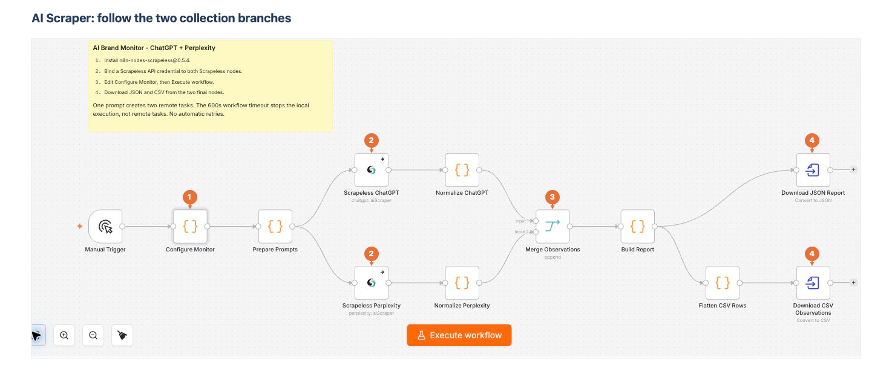](images/ai-brand-monitor-canvas.png)

*1: Configure the brand and questions. 2: Configure both AI Scraper nodes. 3: Keep both normalized branches connected to Merge Observations. 4: Configure the JSON and CSV export nodes. Select any screenshot to view it full size.*

[Download the AI Scraper workflow](workflows/ai-brand-monitor.json)

In the n8n editor, open the workflow menu and choose **Import from File**. After importing, the canvas contains the question configuration, two AI Scraper branches, a merge, and two file-export paths.

Send the same questions to ChatGPT and Perplexity, collect their answers and returned sources, and check whether they mention your brand or link to its domain. Use it to compare platform responses to product-category questions and prepare data for a brand review.

The workflow uses **AI Scraper** and exports JSON and CSV files. The only service credential it needs is your **Scrapeless API** key.

Before running, [configure the Scrapeless API credential](#credentials-used).

#### Workflow Overview

1. **Prepare questions:** Configure the brand, aliases, domains, country, and prompts.
2. **Collect answers:** Submit each question to ChatGPT and Perplexity with AI Scraper.
3. **Align observations:** Normalize each platform's answer and source fields.
4. **Build the report:** Merge the two branches and prepare the brand-monitoring report.
5. **Create files:** Export JSON and CSV through the two final nodes.

##### Brand and question configuration

Open **Configure Monitor → Parameters**. Keep **Mode = Run Once for All Items** and **Language = JavaScript**. Edit only the `config` object at the top of the code; use the editor's expand control if you need more space.

[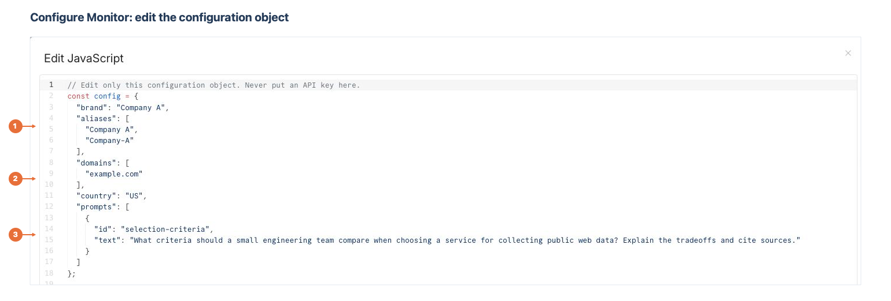](images/ai-brand-monitor-inputs.png)

*1: Set the brand and aliases. 2: Enter bare domain names and a request country. 3: Give each question a unique id and its question text.*

```json
{
  "brand": "Company A",
  "aliases": ["Company A", "Company-A"],
  "domains": ["example.com"],
  "country": "US",
  "prompts": [
    {
      "id": "selection-criteria",
      "text": "What criteria should a small engineering team compare when choosing a service for collecting public web data? Explain the tradeoffs and cite sources."
    }
  ]
}
```

| Input | How to configure it |
| --- | --- |
| `brand` | Enter the brand name to monitor |
| `aliases` | Add other spellings that should count as a mention |
| `domains` | Use bare hostnames, such as `example.com`, without `https://` or a path |
| `country` | Use a supported two-letter uppercase request country code |
| `prompts` | Supply one to ten questions, each with a unique `id` and non-empty `text` |

For a category-visibility question, leave the brand out of the question text. The workflow does not insert it automatically. Start with one prompt; each prompt creates one task per engine.

##### AI Scraper parameters

Open **Scrapeless ChatGPT** and **Scrapeless Perplexity**. Select your saved credential in both, then use the following settings.

[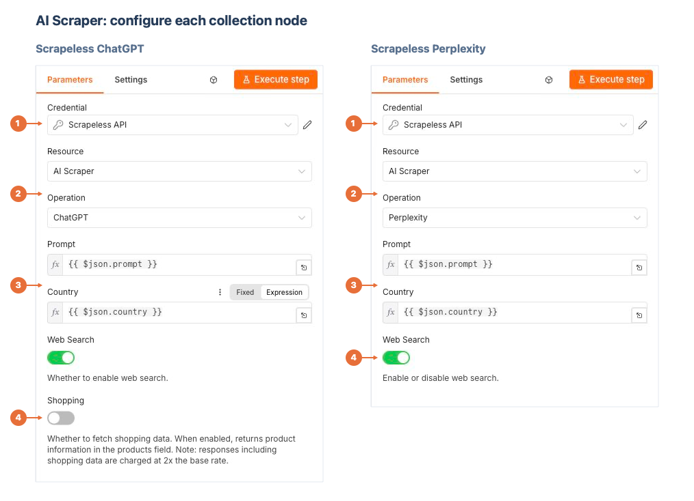](images/ai-brand-monitor-parameters.png)

*1: Select the credential. 2: Choose AI Scraper and the corresponding operation. 3: Map Prompt and Country with expressions. 4: Enable Web Search in both nodes and disable Shopping in ChatGPT.*

| Parameter | Scrapeless ChatGPT | Scrapeless Perplexity |
| --- | --- | --- |
| **Credential** | Your saved Scrapeless API credential | The same credential |
| **Resource** | AI Scraper | AI Scraper |
| **Operation** | ChatGPT | Perplexity |
| **Prompt** | Expression: `{{ $json.prompt }}` | Expression: `{{ $json.prompt }}` |
| **Country** | Expression: `{{ $json.country }}` | Expression: `{{ $json.country }}` |
| **Web Search** | On | On |
| **Shopping** | Off | Not used by this operation |

For **Prompt** and **Country**, switch the field to **Expression** before entering the expression. These fields read each question item prepared by **Prepare Prompts**. Leave the imported normalization and report code in place.

#### Workflow Connections

| Connection | Purpose |
| --- | --- |
| **Manual Trigger → Configure Monitor → Prepare Prompts** | Prepare the configured questions |
| **Prepare Prompts → Scrapeless ChatGPT → Normalize ChatGPT** | Collect and align the ChatGPT answers |
| **Prepare Prompts → Scrapeless Perplexity → Normalize Perplexity** | Collect and align the Perplexity answers |
| **Normalize ChatGPT → Merge Observations, input 1** | Feed the first engine into the merge |
| **Normalize Perplexity → Merge Observations, input 2** | Feed the second engine into the merge |
| **Merge Observations → Build Report → Download JSON Report** | Build and export the JSON report |
| **Build Report → Flatten CSV Rows → Download CSV Observations** | Prepare rows and export the CSV |

Keep **Merge Observations → Mode = Append**. **Prepare Prompts**, both **Normalize** nodes, **Build Report**, and **Flatten CSV Rows** are already configured in the imported workflow.

#### Final Output and Export Configuration

The two final nodes use n8n's built-in **Convert to File** node.

[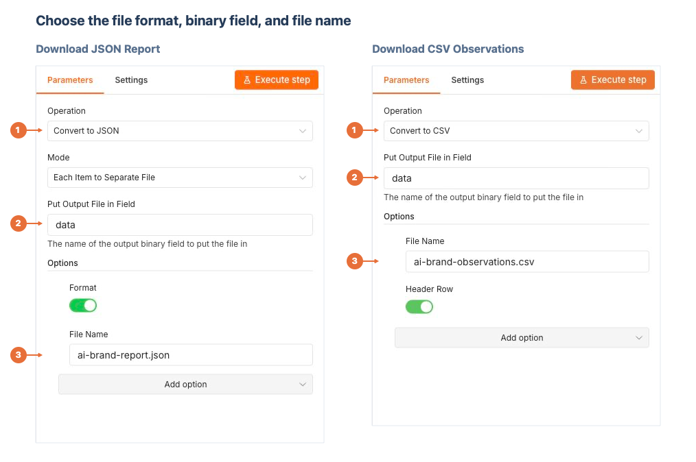](images/ai-brand-monitor-exports.png)

*1: Choose the file conversion operation. 2: Keep Put Output File in Field set to data. 3: Set the file name.*

| Node | Operation | File Name |
| --- | --- | --- |
| **Download JSON Report** | Convert to JSON | `ai-brand-report.json` |
| **Download CSV Observations** | Convert to CSV | `ai-brand-observations.csv` |

For the JSON node, keep **Mode = Each Item to Separate File** and **Format = On**. For the CSV node, keep **Header Row = On**. Both use **Put Output File in Field = data**.

Return to the canvas and select **Execute workflow**. After it finishes, open either export node and use **Binary → Download** to save the file. JSON contains the report and underlying observations; CSV provides one row per question and engine.

#### Credentials Used

- **Scrapeless API:** select the same saved credential in **Scrapeless ChatGPT** and **Scrapeless Perplexity**.
- This workflow does not require separate ChatGPT or Perplexity API keys.

1. Create a [Scrapeless account](https://app.scrapeless.com/passport/register?utm_source=github&utm_medium=referral&utm_campaign=n8n-nodes-scrapeless), or sign in to your existing account. Open **API Key Management** in the dashboard and create or copy an API key.

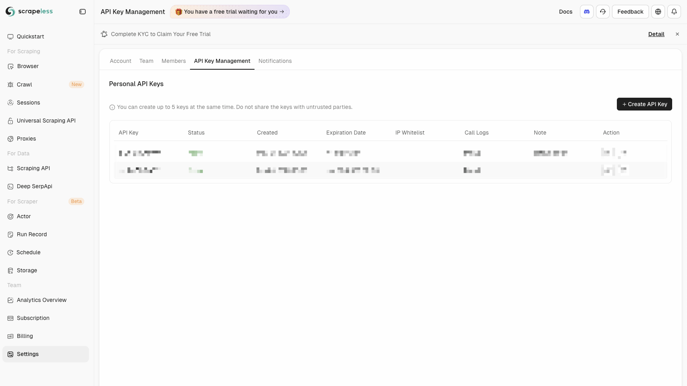

2. In an n8n Scrapeless node, open **Credential → Create new credential**.
3. Enter your key in **API Key**, then select **Save**. Give the credential a recognizable name, such as `Scrapeless API`.

[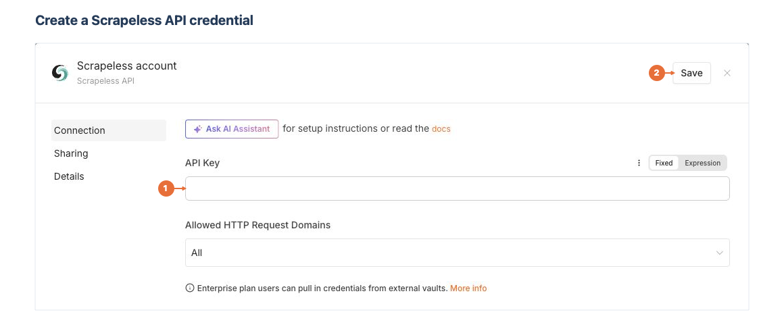](images/n8n-credential-setup.png)

*1: Enter your API key. 2: Save the credential. The screenshot uses an empty field to show the setup location.*

Select this saved credential in each workflow's Scrapeless nodes. Keep the key in n8n credentials; the downloadable JSON files contain no keys or credential IDs.

#### External Nodes Used

- **Community node:** `n8n-nodes-scrapeless`, using its AI Scraper resource.
- **Built-in nodes:** Manual Trigger, Code, Merge, and Convert to File.
- No other community package is needed.

### TL;DR - Web Unlocker: Page to Report

[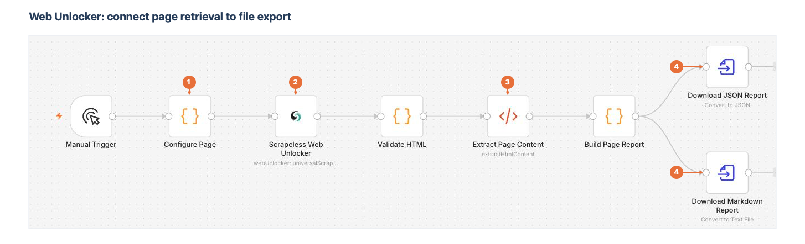](images/web-unlocker-canvas.png)

*1: Set the target URL. 2: Configure Web Unlocker. 3: Check the HTML extraction rules. 4: Configure the two file exports.*

[Download the Web Unlocker workflow](workflows/web-unlocker-page-report.json)

Choose **Import from File** in n8n. The imported canvas connects page configuration to Web Unlocker, HTML extraction, report preparation, and two export nodes.

Retrieve a public page with **Web Unlocker**, then extract its title, description, headings, body text, and links. Use it to collect product-page information, prepare research material, or pass structured page content to another workflow.

This independent workflow uses **Web Unlocker**, the built-in **HTML** node, and JSON/Markdown file export. It uses your **Scrapeless API** credential and needs no additional service account.

Use the same [Scrapeless API credential](#credentials-used) as the AI Scraper workflow.

#### Workflow Overview

1. **Set the target:** Configure the public page URL and request country.
2. **Retrieve the page:** Use Web Unlocker with JavaScript rendering enabled.
3. **Extract content:** Validate the HTML response and extract the configured page fields.
4. **Prepare the report:** Clean the extracted values and apply the export limits.
5. **Create files:** Export the page report as JSON and Markdown.

##### Target page configuration

Open **Configure Page → Parameters** and keep **Mode = Run Once for All Items**. Edit the configuration object at the top of its JavaScript code.

[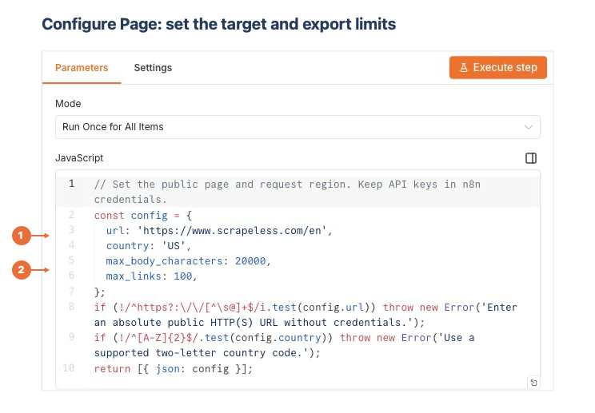](images/web-unlocker-inputs.png)

*1: Enter the public URL and request country. 2: Set the body-text and link export limits. Leave the validation code below the object in place.*

```json
{
  "url": "https://www.scrapeless.com/en",
  "country": "US",
  "max_body_characters": 20000,
  "max_links": 100
}
```

| Input | How to configure it |
| --- | --- |
| `url` | Enter the full public page URL, including `https://` |
| `country` | Use a supported two-letter uppercase request country code |
| `max_body_characters` | Set the maximum body-text characters kept in the report |
| `max_links` | Set the maximum number of distinct links exported |

##### Web Unlocker parameters

Open **Scrapeless Web Unlocker** and select the same **Scrapeless API** credential used elsewhere in the guide.

[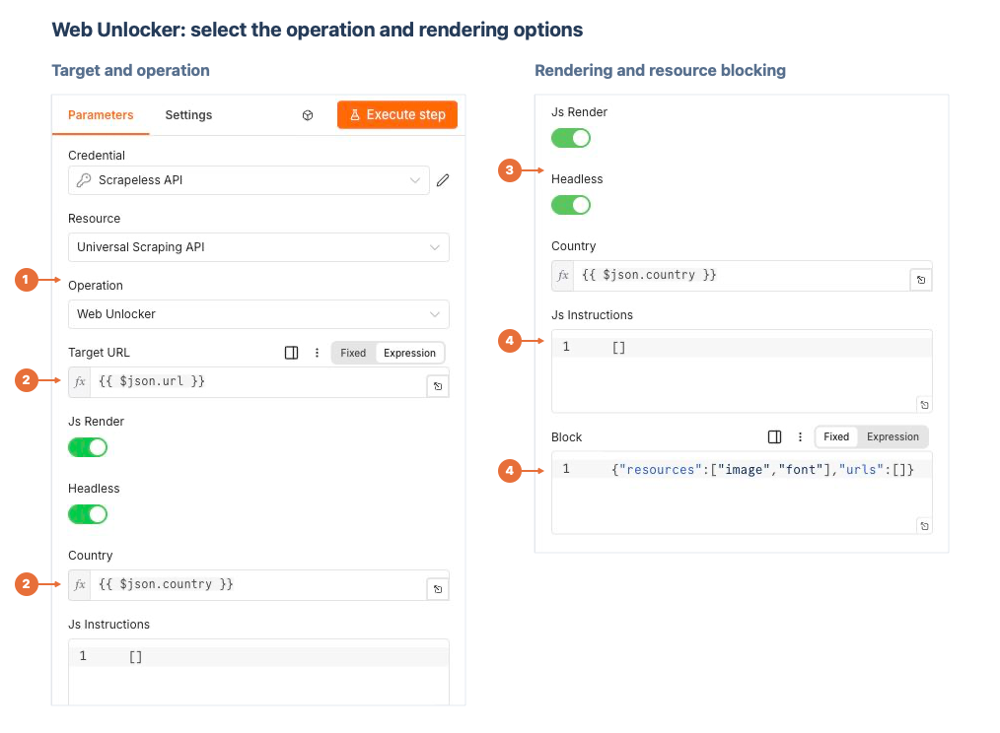](images/web-unlocker-parameters.png)

*1: Select Universal Scraping API → Web Unlocker. 2: Map Target URL and Country with expressions. 3: Enable Js Render and Headless. 4: Set the JSON instructions and resource-blocking rules.*

| Parameter | Setting |
| --- | --- |
| **Resource** | Universal Scraping API |
| **Operation** | Web Unlocker |
| **Target URL** | Expression: `{{ $json.url }}` |
| **Js Render** | On |
| **Headless** | On |
| **Country** | Expression: `{{ $json.country }}` |
| **Js Instructions** | Fixed JSON: `[]` |
| **Block** | Fixed JSON: `{"resources":["image","font"],"urls":[]}` |

Switch **Target URL** and **Country** to **Expression**. Leave **Js Instructions** and **Block** as fixed JSON. The example blocks images and fonts while allowing scripts to run.

##### HTML extraction parameters

Keep **Validate HTML** between the Scrapeless node and the HTML node. Then open **Extract Page Content**.

[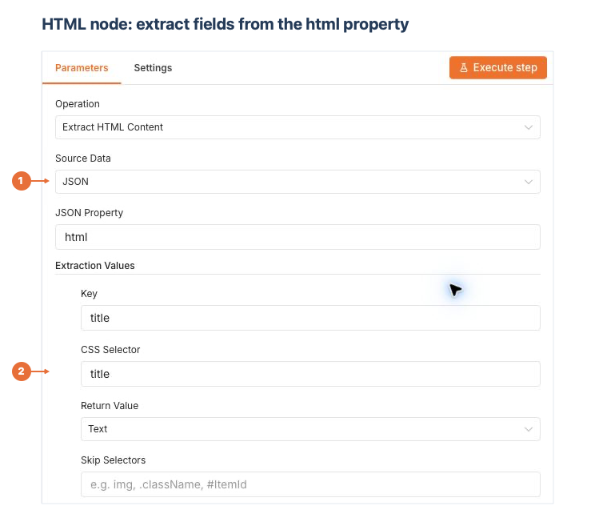](images/web-unlocker-html.png)

*1: Choose Extract HTML Content, Source Data = JSON, and JSON Property = html. 2: Define each extraction value with a Key, CSS Selector, and Return Value.*

Under **Extraction Values**, use **Add Value** to configure the fields below. They are already included in the downloadable workflow.

| Key | CSS Selector | Return Value / Attribute | Return Array |
| --- | --- | --- | --- |
| `title` | `title` | Text | Off |
| `description` | `meta[name="description"]` | Attribute: `content` | Off |
| `headings` | `h1, h2` | Text | On |
| `body` | `body` | Text | Off |
| `links` | `a[href]` | Attribute: `href` | On |

For `body`, set **Skip Selectors** to `script, style, noscript, template, svg, nav, header, footer, aside`. Under **Options**, enable **Trim Values** and **Clean Up Text**.

For a specific product or article page, change the CSS selectors to match that page's content area. Keep `links` as original `href` values; relative links are not converted to absolute URLs by this workflow.

#### Workflow Connections

| Connection | Purpose |
| --- | --- |
| **Manual Trigger → Configure Page → Scrapeless Web Unlocker** | Supply the target page and retrieve HTML |
| **Scrapeless Web Unlocker → Validate HTML → Extract Page Content** | Validate the response and extract page fields |
| **Extract Page Content → Build Page Report** | Clean the fields and prepare the report |
| **Build Page Report → Download JSON Report** | Export the JSON file |
| **Build Page Report → Download Markdown Report** | Export the Markdown file |

#### Final Output and Export Configuration

Leave the imported **Validate HTML** and **Build Page Report** code in place. Configure the two final **Convert to File** nodes as shown.

[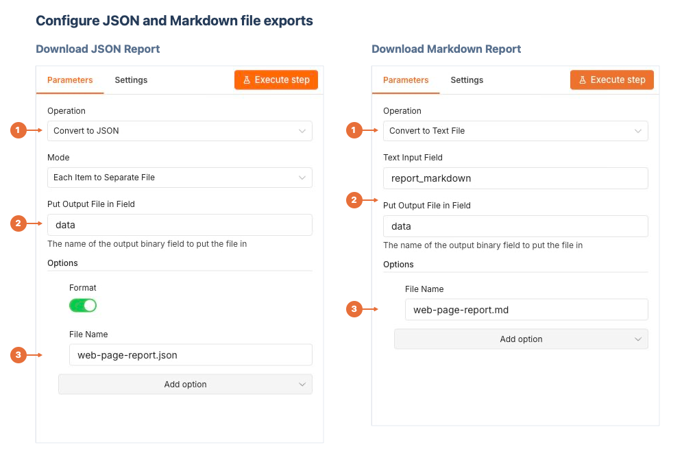](images/web-unlocker-exports.png)

*1: Choose the conversion operation. 2: Set the input/output fields. 3: Set the file name.*

| Node | Operation | File Name |
| --- | --- | --- |
| **Download JSON Report** | Convert to JSON | `web-page-report.json` |
| **Download Markdown Report** | Convert to Text File | `web-page-report.md` |

Both use **Put Output File in Field = data**. In the JSON node, keep **Mode = Each Item to Separate File** and **Format = On**. In the Markdown node, set **Text Input Field = report_markdown**.

Return to the canvas, select **Execute workflow**, and open either export node after execution. Choose **Binary → Download** to save the JSON or Markdown file.

#### Credentials Used

- **Scrapeless API:** select your saved credential in **Scrapeless Web Unlocker**.
- Follow the [credential setup in the main example](#credentials-used) if you have not created it yet. No additional service credential is required.

#### External Nodes Used

- **Community node:** `n8n-nodes-scrapeless`, using Universal Scraping API → Web Unlocker.
- **Built-in nodes:** Manual Trigger, Code, HTML, and Convert to File.
- No other community package is needed.

## Contribution

To work on the node locally, clone the repository, install its dependencies, and build the package:

```sh
git clone https://github.com/scrapeless-ai/n8n-nodes-scrapeless.git
cd n8n-nodes-scrapeless
npm ci
npm run build
```

When proposing a change, describe the affected operation and the steps used to check it.

## About

[Scrapeless](https://www.scrapeless.com/en?utm_source=github&utm_medium=referral&utm_campaign=n8n-nodes-scrapeless) provides the APIs used by the Scrapeless Official n8n community node.

## Contact us

For product and API support, contact us through [Discord](https://discord.gg/stFPK2xKHY) or [Telegram](https://t.me/scrapeless). You can also visit our [Contact Support](https://docs.scrapeless.com/en/help/contact-support/) page.
